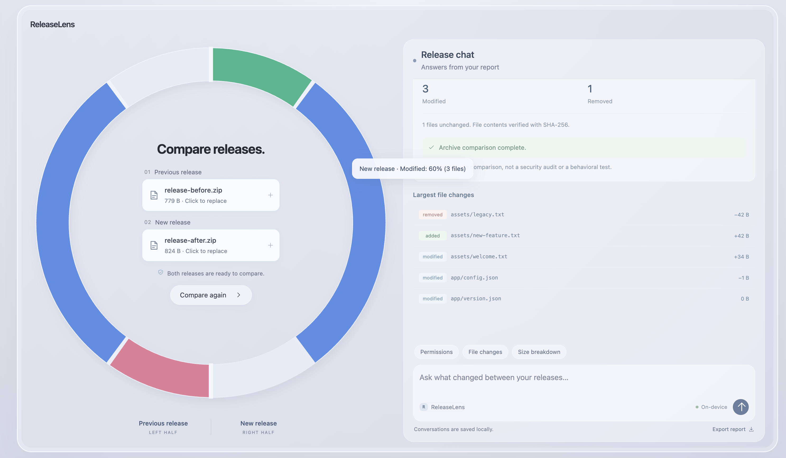
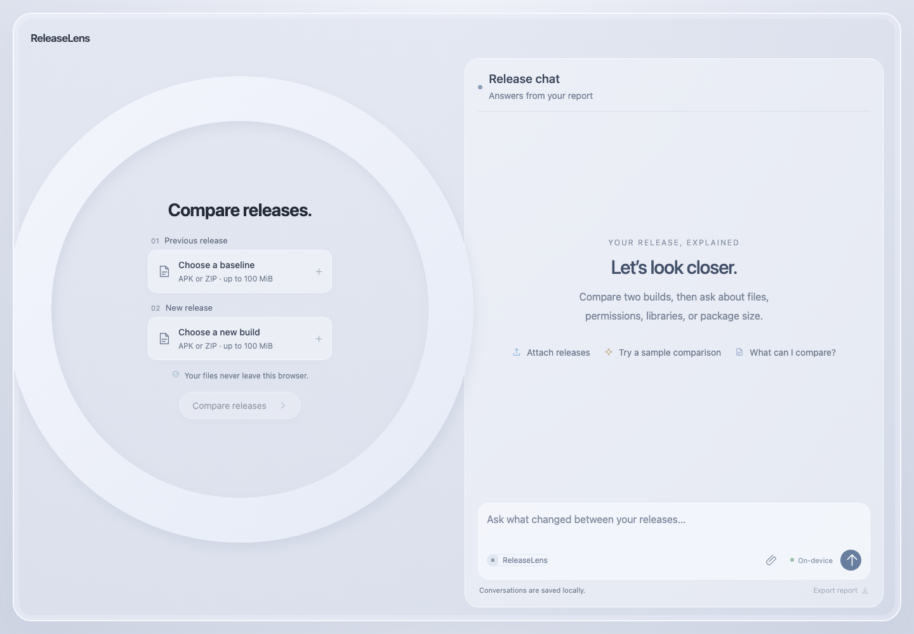
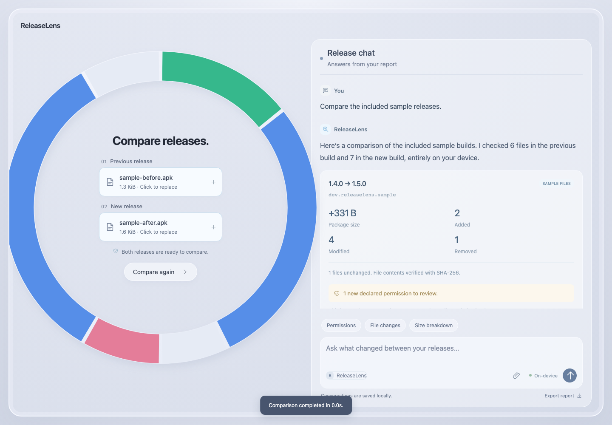

# ReleaseLens

A local-first, chat-style workspace for understanding what changed between app releases. Rust performs archive inspection and SHA-256 comparisons in a browser Web Worker; the interface and reports stay on your device.

## Run locally

Requires Node.js 20.19+ or 22.12+. The compiled WebAssembly engine is included.

```sh
npm ci
npm run dev
```

Open the URL printed by Vite. Choose a previous build and a new build, then send a question. **Try a sample comparison** uses included, non-installable APK-shaped ZIP fixtures and runs the same Rust engine as uploaded files.

## Screenshots







[Mobile screenshot](docs/screenshots/mobile.png)

## What it compares

- Added, removed, modified, and unchanged files, verified by SHA-256 of decompressed contents.
- Download size and expanded file sizes, with searchable file changes.
- APK package identifiers, versions, SDK levels, and declared permission changes (binary AXML and text XML).
- Mac app identifiers and versions from XML or binary `Info.plist` files.
- Added/removed Android `.so` paths and Mac `.dylib` / bundled `.framework` paths.
- JSON and standalone HTML report downloads.

Ask about **permissions**, **SDK levels**, **size**, **changed files**, or **native libraries**. Chat uses predefined local question handling, not an AI service. It cannot answer arbitrary source-code questions.

## Supported files and limits

Compare two APKs, two ZIPs containing one Mac `.app` each, or two general ZIP archives. Mac app root names are normalized; Finder metadata is ignored. Files are read but never extracted to disk or executed.

Each archive is limited to 100 MiB compressed, 512 MiB expanded, 128 MiB per entry, and 20,000 entries. Metadata files are limited to 4 MiB. Ambiguous paths, duplicate paths, unreadable data, mismatched app identifiers, and mismatched archive types are rejected. Encrypted ZIPs, AAB, IPA, and DMG analysis are not supported. Only ZIP compression formats supported by the bundled engine can be read.

This is a package-difference tool, **not a security audit**. It does not verify signing certificates, detect malware, decompile DEX, resolve every dependency/version, compare Mac entitlements, or test runtime behavior. Manifest parsing warnings are shown in the report.

## Privacy

No app archives are uploaded. There is no application backend, account, external model, remote font, or analytics integration. The last eight conversations and their report data are saved in browser local storage; archive bytes are not persisted. Large reports may be omitted from history to keep storage bounded. Settings can clear saved conversations. Reports contain file paths and metadata; share them deliberately.

## Deploy to Vercel

Import this folder as a Vite project. `vercel.json` sets:

- Build: `npm run build`
- Output: `dist`

The checked-in `public/engine/releaselens.wasm` is served as a static asset. No server functions, secrets, file-upload storage, or Rust compiler are required at deployment time. If you change the Rust engine, rebuild the WASM file and include it with your deployment source.

## Develop the engine

Install a Rust toolchain and the WASM target:

```sh
rustup target add wasm32-unknown-unknown
npm run test:engine
npm run build:engine
npm run build
```

The engine uses a small allocation/JSON interface, with no JavaScript fallback. Source: `engine/src/lib.rs`. `Cargo.lock` pins Rust dependencies.

## Browser checks

```sh
npx playwright install chromium
npm run test:e2e
# After npm run build, verify the production bundle with Vercel headers:
node tests/production-smoke.mjs
```

Playwright starts a local Vite server and checks sample analysis, follow-up questions, exports, uploads, history, errors, cancellation, and mobile layout. Optional integration tests use `RELEASELENS_INTEGRATION_APK` and `RELEASELENS_INTEGRATION_MAC_ZIP` paths; they are skipped when those variables are absent.

## Theme skill

The reusable reference-based theme is in [`.agents/skills/clear-workspace-theme/SKILL.md`](.agents/skills/clear-workspace-theme/SKILL.md), with portable CSS tokens in its `assets/` directory. It covers the rail/sidebar/chat layout, colors, typography, controls, empty state, motion, and responsive behavior. Project `AGENTS.md` routes future interface work to it. This is a project-local skill, not a globally installed artifact template.
